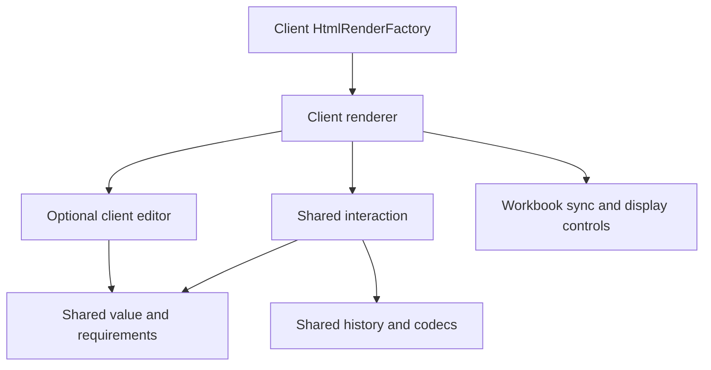

# Interaction models, renderers and editors

The saved interaction value is the source of truth. A shared interaction defines
an exercise; a client renderer connects it to the workbook; an optional standalone
editor changes the supplied value. This guide states the intended dependency
boundaries and names current integration limits explicitly.

## Modules and responsibilities

| Layer | Location | Responsibility |
| --- | --- | --- |
| Domain/interaction | `modules/core/shared` | Saved data, configuration, pure algorithms, validation, grading/scaffolding contracts and cross-platform codecs |
| Platform bridges | `modules/core/js`, `modules/core/jvm` | Platform-specific adapters; the JS `StateHelper` bridge is not JVM code |
| Renderer | `modules/client` | Reactive preview/labels, state binding and editor/fullscreen composition |
| Editor | `modules/client` | Controls and transient drafts/selection; changes the supplied bound `Var` |
| Worker/server | `modules/worker`, `modules/server` | Execute supported shared commands using dependencies available on that backend |

Shared core must work on JVM and Scala.js. Do not import Laminar, browser JSON/XML
APIs, DOM or a client renderer into it. Put reusable domain calculations there;
keep only browser integration and presentation in client. This does not prohibit
client-local UI state. Saved answer types must remain deserializable without the
client. The legacy EVA2 client model is currently adapted to a shared persisted
floor/experiment at that boundary; it is not the desired template for new domain
models.



An editor should be usable outside a workbook: receive its `Var[T]`, domain
requirements/configuration and required services. Observe changes through its Var
signal rather than adding editor-listener callbacks. It should not look up
its interaction, own a second persistence store or call a workbook renderer.
The renderer supplies those inputs and handles placement in the workbook.
A small inline interaction need not introduce a separate editor or fullscreen.

## Element types and state

[WorkbookElement.scala](../modules/core/shared/src/main/scala/it/evadid/workbook/abstractions/WorkbookElement.scala)
defines the common ID, children and definition factory:

The hierarchy separates displayed content, structural containers and interactions
with saved values and typed grading/scaffolding payloads. Implementations live
under `modules/core/shared/src/main/scala/it/evadid/workbook/elements/`.
Mixed traversals use the existential interaction type; new integrations should
retain concrete payload types rather than widening them to `Any`.

The shared `InteractionVariable[T, GA, SA]` owns history and current value through
`State`. The renderer bridges a bound state to a browser `Var` with `StateHelper`.
[State and serialization](state-and-serialization.md) provides complete binding,
`bimap`, observer-lifetime, update-importance and codec examples. The interaction's
`defaultValue` is an initializer, not another live answer. History synchronization
is destination/strategy-dependent; it is not an unconditional database write for
every keystroke.

## Renderer → editor example

This is the current QR pattern: one bound value is used by the preview and editor.
The renderer owns the workbook controls, while `QrCodeEditor` accepts the value and
requirements. Inside `CreateQrCodeInteractionRenderer.createRendering`:

```scala
val state = element.interactionVariable
  .createBoundStateWithUpdateImportance(fullInfo.syncControl, UpdateImportance.MAJOR)
  .toAirstreamVar
val open = HtmlButtonElement.withTextLabel("basic/OpenEditor", _ =>
  fullInfo.displayControl.setFullscreen(QrCodeEditor(state, element.requirements)))
AtomarLineRendering.cardLine(element, List(
  ElementCard(LanguageMapContentId("basic/openEditor"), open.getDomElement()),
  ElementCard(LanguageMapContentId("basic/qrTitle"),
    QrCodeView.preview(state.signal, element.requirements))
))
```

Read the [complete renderer and imports](../modules/client/src/main/scala/it/evadid/homepage/workbook/htmlRenderer/interactionRenderer/qr/CreateQrCodeInteractionRenderer.scala).
`HtmlRenderFactory` dispatches the model to a `LineBasedRenderingFactory`, which
produces an `AtomarLineRendering`. Fullscreen uses `displayControl.setFullscreen`
with an `HtmlAppElement`; editors owning work implement the appropriate
mount-owned cleanup. Closing removes and unmounts the dialog child. Reopening
creates a new mounted editor from current state; there is no fullscreen lifecycle
interface or retained hidden editor. Native resources and subscriptions belong to
Laminar owners.

Local incomplete numeric/text drafts may differ from the saved value while
validation is pending. Decide explicitly whether drafts are persisted: QR keeps
invalid text local, whereas answer tables intentionally save entered strings.
Document close/reset behavior for each editor.

## Grading and scaffolding

Shared core supplies generic grading/scaffolding contracts. An interaction has a list of
`WorkbookInteractionGrader[T, GA]` and at most one
`WorkbookInteractionScaffolder[T, SA]`. Use concrete serializable payload types for
new typed integrations; additional data belongs in `GA`/`SA`, not a subclass of
`GradedState`.

A grader returns an asynchronous result tied to the exact source value, with
status, localized feedback and optional typed additional data. Manual-only graders
run only when explicitly forced. Keep independent checks in separate graders
when they need separate feedback.

`InteractionVariable.startGrading(syncControl, forceGrading)` collects results into
`GradedState[T, GA](state, testsWithResults)` and stores them by value in history.
`updateStateFromUserInteraction` requests grading; the simple bound-value setters
currently store edits without calling `startGrading`. Importance alone does not
schedule grading or debounce expensive tests. `SlideshowGrader` is an implementation
example; an interaction must actually attach a grader to `gradingElements` to run it.
Register new grader codecs in `WorkbookInteractionGrader.universalSerializer`.

`TextInputWithScaffoldingAndGrading` owns its description, saved string answer,
hint IDs and criterion IDs. Each `TextInputLlmGrader` resolves exactly one criterion
and the task using the request's selected language (English content fallback).
Pass the resolver to `startGrading`; its returned Future completes after history
is updated. LLM graders run manually. Responses end in `CORRECT`, `INCORRECT` or
`PARTIALL_CORRECT`; that marker becomes the status and is removed from feedback.
A missing marker allows one classification-only retry; another invalid response
is a `TestError`. Graders use `FeedbackEntity.LlmEntity`; typed additional data
stores the request/response transcript without changing grader identity.
The inline renderer reuses `SimpleTextEditor` and the standard hint panel.
History synchronization uses the latest answer, grading or scaffolding timestamp;
feedback-only updates therefore persist without adding dummy answer edits.
Legacy hints without a timestamp read with a stable minimum timestamp.

The scaffolder contract is `generateFeedback(currentState):
Future[ScaffoldingResult[T, SA]]`, with feedback tied to the source value.
The standard interaction info panel offers manual scaffolding for attached
scaffolders; it invalidates hints on answer/language changes. Scaffolding does not
run automatically while typing.
`InteractionInfoPanel` renders synchronization status but its generic grading icon
is empty. Existing task-specific requirement feedback and the separate GPT/chat
or feedback-demo elements do not imply a complete generic grading/scaffolding UI.
These are specific integration limits, not evidence that the worker backend or
shared grading/result models are unfinished.

## Localization and presentation

Use `LanguageMapContentId` for authored instructions and renderer labels. Maps live
in `resources/languageMaps/eva/<group>/map-<language>.json`, with universal content
where appropriate. `LanguageMapStorageControl` registers sources;
`laminarHelper.plaintextStringSignal(id)` follows the selected language and fallback.
`contentIdStringSignal(id, PLAINTEXT_UNDERSCORE_REPLACABLE, replacements)` supplies
underscore substitutions. Avoid taking a one-time language snapshot for controls
that must update after a language switch.

```scala
val title = LanguageMapContentId("basic/openEditor")
h3(text <-- laminarHelper.plaintextStringSignal(title))
```

Put static layout/color rules in dedicated `homepage/css` files, reusing
`generic/colors.css` and `generic/dimensions.css` tokens. Laminar binds semantic
classes and state. Canvas/SVG boundaries may need computed coordinates/style values;
self-contained exports must retain their appearance outside the workbook. Those
values do not justify arbitrary duplicated palettes or static inline layout rules.

## Dependencies and execution

Prefer a few reusable frameworks and cross-platform libraries. Browser programs
should normally be versioned, complete distributions under `resources/programs`;
resolve assets through `fullInfo.contentControl.fileFactory.relativeToTechnicalResources`.
CodeMirror currently uses pinned CDN modules with an offline test bundle, so
vendoring all editor assets is an architectural target, not an accomplished fact.
Snap and JSXGraph have bundled distributions.

Native readiness and typed handle creation belong to core JS's `it.evadid.facades`,
with one file per dependency. Page startup schedules preloads without awaiting
optional runtimes; renderers provide local fallbacks and own mounted resources.
See [browser startup loading](browser-startup-loading.md) for the contract and
[Eva editor architecture](eva-editor-programming-state.md) for lifecycle rules.

The generic execution backend is implemented. Choose local, HTTP/server or worker
execution according to required resources; a main-thread `Future` alone does not
make CPU work parallel. See [execution clients](execution-clients.md) for complete
command definitions/calls and [worker execution](worker-execution-backend.md) for
supported jobs. [Cache/startup](laminar-workbook-catalog-and-cache.md) documents
implemented IndexedDB restoration and independent refresh.

## Current examples and authoring checklist

| Example | Reusable pattern / current boundary |
| --- | --- |
| [QR](qr-code-interaction.md) | Shared symbol/requirements, bound preview and standalone fullscreen editor |
| [Mail](email-simulator.md) | Shared mailbox transitions, local compose drafts and supplied editor state |
| [Compression](compression-workbook.md) | Shared saved experiment data with client controls/playback |
| Choice, answer tables, pixels, Unicode | Inline controls need no separate fullscreen editor |
| [Embroidery](embroidery-preview-workbook.md) | `TurtleRecreateShapeInteraction` stores `ProgrammingState` and target/palette/policy; drawing comparison is not a complete generic grader |
| Evacuation | Shared saved floor/experiment with a client adapter to the legacy EVA2 simulation |
| [SQL](sql-editor.md) | Shared answer/configuration and typed server execution; JDBC is server-only |
| [Eva](eva-editor-programming-state.md) | One active editor, central Var, asynchronous conversions and downstream panels |

For turtle recreation, the current base is `WorkbookInteractionElement[ProgrammingState]`.
`limitTurtleCommandUsage` remains authored configuration, but the current renderer
neither passes it to the editor nor enforces it. Do not describe visual comparison
as complete task grading. For mail, the shared writing-practice model `MailEditor`
and client UI `MailEditor` have different responsibilities despite sharing a name.

When adding an interaction, define shared data/requirements/codecs, register its
factory and renderer, bind one saved state and introduce an editor only when useful.
Test shared behavior/round trips on both platforms, local draft/lifecycle logic in
client, and actual persistence/fullscreen/invalid-draft behavior in browser checks.
The [test guide](core-package-unit-tests.md) and
[serialization inventory](testing-and-serialization-audit.md) provide current commands.
